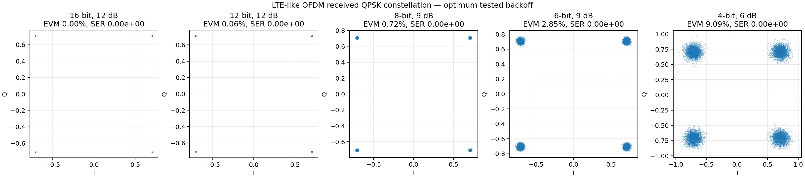
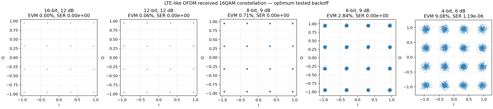
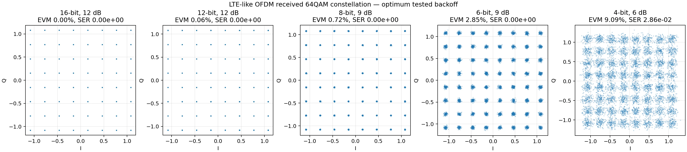
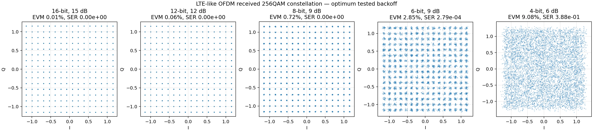

+++
title = 'PlutoSDR wastes 25% of its USB2 throughput on redundant bits'
date = 2026-10-31
description = 'Packing and quantizing PlutoSDR samples to trade precision and CPU time for USB throughput.'
draft = true
tags = ['SDR', 'PlutoSDR', 'DSP', 'USB', 'telcom', 'LTE']
ShowToc = true
+++

Analog Devices' ADALM-Pluto SDR is famously limited by its USB2 connectivity and clock stability, giving rise to popular forks ([Pluto+](https://opensourcesdrlab.com/products/pluto-plus), [AntSDR E200](https://www.crowdsupply.com/microphase-technology/antsdr-e200)) that include Gigabit Ethernet and a better clock.

On the original board though, while there are many mods available for improving clock stability, including [external clock modifications](https://osmocom.org/issues/5892), [feeding in a reference clock](https://forum.amsat-dl.org/index.php?thread/3199-external-clock-for-adalm-pluto/) and a [simple U.FL IPEX connector on rev D](https://ez.analog.com/adiacademy/university-program/f/q-a/77922/will-it-be-possible-to-feed-in-a-reference-clock-to-the-adalm-pluto), there are not many options to alleviate the USB2 bandwidth constraints.

Turns out, the native IIOD wastes 33% of its throughput on meaningless data.

## What ??

A complex sample has an in-phase component, $I$, and a quadrature component, $Q$.

The PlutoSDR ADC produces [12-bit $I$ and $Q$ values](https://www.analog.com/media/en/technical-documentation/data-sheets/ad9363.pdf#:~:text=produce%20a%2012-bit%20output%20signal). They are then put into 16-bit words by the HDL (which [pads it with 1s or 0s according to the sample's sign](https://github.com/analogdevicesinc/hdl/blob/main/library/common/ad_datafmt.v#L89-L96)) and shipped via DMA to the IIOD daemon which happily [transfers it as is](https://github.com/analogdevicesinc/libiio/blob/v0.25/iiod/ops.c#L468-L518) across the USB bus.

That makes an IQ sample use four bytes of bandwidth when its useful data fits in three.

Theoretically, **we should be able to get 33% more sustained bandwidth for free, without loss of precision**[^pack12-range]. If our code can keep up. 

[^pack12-range]: In some configurations, the Pluto receive path may produce values outside the signed 12-bit range ([FPGA offset addition](https://github.com/analogdevicesinc/hdl/blob/main/library/xilinx/common/ad_dcfilter.v#L99-L113), [driver calibration bias](https://github.com/analogdevicesinc/linux/blob/main/drivers/iio/adc/cf_axi_adc_core.c#L639-L645)). PACK12 does not preserve those values. The real-world impact is TBD, and further hardening may be required.

## Bit packing in IIOD

### Attempt 1: Naive packing
The first POC packed each pair of little-endian 16-bit I/Q containers into three bytes before sending them.
This is the original packing loop from commit 852d5eb7:

```c
static inline size_t packed12_pack_scalar(void *dst, const void *src, size_t n) {
    unsigned char *d = dst;
    const unsigned char *s = src;
    size_t j;

    // ...
    for (j = 0; j < n; j += 4, s += 4, d += 3) {
        d[0] = s[0];                      // IIII IIII
        d[1] = (s[1] & 15) | (s[2] << 4); // IIII QQQQ
        d[2] = (s[2] >> 4) | (s[3] << 4); // QQQQ QQQQ
    }
    // ...
}
```

Note that we naively used batches of $n=4096$ bytes, which after packing gave $3,072$ byte writes. 

**Performance result:** 3.682 MS/s (native 7.241 MS/s). 49.15% lower throughput than native.

**Main problem:** Not only did we add the CPU overhead of packing, but we also didn't reduce the overall number of transfers. In fact given the 25% payload reduction, we could say that we've decreased performance by ~70%. Ouch.

<!-- Source: libiio-packed12-poc, commit 852d5eb7, packed12.h; campaign benchmark-report.md. -->

### Attempt 2: Just use larger batches
The packing code stayed the same. The change was to pack and transfer more data per operation rather than issuing many small writes.

```c
#define PACKED12_NATIVE_BATCH 4194304U // We treat up to 4MiB per packing. 

// ...
// In the send loop:

if (n > PACKED12_NATIVE_BATCH) {
    n = PACKED12_NATIVE_BATCH;
}
packed12_pack_scalar(thd->packed12_scratch, (char *)start + done, n);
ret = write_all(pdata, thd->packed12_scratch, n / 4 * 3); // Due to our 16->12 bit packing
```

Note that we don't wait until accumulated `PACKED_NATIVE_BATCH` to pack, otherwise the latency would be insane. But at least it should help with keeping the write buffer fed. 

**Performance result:** 7.208 MS/s (native 7.122 MS/s). We're 95.76% faster than the previous attempt, but still only 1.20% faster than native. Not too much to brag about, but at least it's not actively worse than native.  

### Attempt 3: ARM NEON packing and host SSSE3 unpacking

Ok, let's bring out the big guns: the [ARM Cortex-A9](https://wiki.analog.com/university/tools/pluto/devs/specs) hardcore in the Zynq XC7Z010 does support NEON, so let's use SIMD to reduce the packing cost by processing 8 IQ samples at once:  

```c
uint8x8x4_t in = vld4_u8(s + done);
uint8x8x3_t out;

out.val[0] = in.val[0];
out.val[1] = vorr_u8(vand_u8(in.val[1], vdup_n_u8(0x0f)),
                     vshl_n_u8(in.val[2], 4));
out.val[2] = vorr_u8(vshr_n_u8(in.val[2], 4),
                     vshl_n_u8(in.val[3], 4));
vst3_u8(d + done / 4 * 3, out);
// ... Omitted: call to the scalar impl for the eventual remaining samples if not divisible by 8.
```

<!-- TODO: don't edit the document but just remind me in the chat to paste the chatgpt infographic that explains this under a AI-xplaining section -->   

This vectorizes the same 4-byte-to-3-byte mapping by deinterleaving the four input byte streams, applying the same masks and shifts, then writing three interleaved output streams.
The host-side also received an x86 SSSE3 unpack implementation because why not.

Performance result: 8.727 MS/s (7.509 MS/s native). +16.22% vs native (over 5 measurements). Yes !

That last result used about 65.5 million samples per run, roughly 8 seconds per measurement.

<!-- Source: benchmark-report.md, “ARM NEON and host SSSE3 optimization”; raw short runs under hardware/watchdog-2p5m-5trials-final/. -->

### TL;DR
- Correct scalar packing, but tiny writes: roughly 44–49% slower in short tests.
- Larger batches: approximately break-even.
- NEON pack and host vector unpack: 14.1–29.6% gain across five sustained pairs

Note that these are measurements of TCP over Pluto's USB Ethernet connection and not iio's direct USB/FunctionFS.

## But why stop here ? Let's quantize

If we can accept a loss in precision, what's stopping us from further reducing the bandwidth per sample by quantizing them on the pluto?

In fact, here is what the payload size landscape could look like:

| Format          | Bits per I/Q pair | Bytes per I/Q pair | Reduction from native |
|-----------------|------------------:|-------------------:|----------------------:|
| Native          |                32 |                  4 |                     — |
| PACK12          |                24 |                  3 |                   25% |
| Q8              |                16 |                  2 |                   50% |
| Q6              |                12 |                1.5 |                 62.5% |
| Q4 (not tested) |                 8 |                  1 |                   75% |


### But doesn't Soapy already do this ?

Yes, Soapy applications can request a stream format such as `SOAPY_SDR_CS16` or `SOAPY_SDR_CS8`

However, this conversion is done host-side by Soapy. This is why the distinction between application format and wire format matters.
An application can request eight-bit samples while a driver receives 16-bit containers and converts them on the host.
That saves no link bandwidth. Here, the client and IIOD explicitly select a wire format, and the client reconstructs the expected native layout after receiving it.


### Impact of quantization on signal quality

As a toy visualisation of the quantization tradeoff, I used an idealized OFDM model with a 1,024-point FFT, 600 active subcarriers and 2,800 symbols. It uses unit-average-energy QAM, component quantization and one fitted common complex gain after the FFT.
This isolates quantization and clipping in the model. Note that this is intended as a visual example and isn't representative of real world performance at all. 

For simulated 256-QAM at 9 dB backoff, EVM was approximately:

| Component width |    EVM |
|-----------------|-------:|
| 12-bit          | 0.215% |
| 8-bit           | 0.723% |
| 6-bit           | 2.848% |

At 12 dB backoff, EVM rose to approximately 0.980% for eight bits and 4.013% for six bits: more backoff reduced clipping but used fewer quantizer levels. Too little backoff has the opposite problem. At 3 dB, 256-QAM EVM exceeded 8% even for the higher-width representations because of clipping.

**QPSK**



**16-QAM**



**64-QAM**



**256-QAM**



<!---
### The test path

The host used libiio's network backend to reach a private experimental IIOD on the Pluto:

```text
Host application → libiio network backend → TCP/IP
    → USB Ethernet gadget → experimental IIOD → local IIO device
```

The stock IIOD stayed running; the experimental daemon listened on a separate restricted port. The test owner checked the device and buffer state, ran bounded captures, stopped the experimental daemon and restored the RX settings. Keeping two daemons running did not make concurrent use of the same RX buffer safe.

The benchmarks counted samples delivered to a null receiver. Receiving the requested count is useful for measuring throughput, but it does not prove that every sample produced by the radio arrived. That would require a continuity-sensitive test, such as a source counter or a validated signal-level marker.
-->

<!-- [TODO: Add the figures, fix the text]
### A more realistic view of the effect of quantization: prerecorded LTE capture

A separate analysis of a previously recorded LTE capture reported a peak-to-average ratio of about 17.68 dB and estimated added EVM of 5.89% for eight bits and 24.14% for six bits. It also reported successful decoding checks at the tested widths.

Those figures use different inputs and methods from the simulation and should not be compared directly. Both analyses show why the signal's use of the available amplitude range matters, especially for Q6.
-->

## Previous work

[Tezuka firmware](https://github.com/F5OEO/tezuka_fw/blob/a304a1f7ecba49dc4cd9d57a7935ec52504c7334/README.md) already offers an eight-bit mode to reduce transport costs.
Its [client code](https://github.com/F5OEO/tezuka_fw/blob/a304a1f7ecba49dc4cd9d57a7935ec52504c7334/app/zynqrx/tools/iio_source.h#L103-L145) enables `voltage0` and disables `voltage1` to select 8-bit mode, then interprets the incoming bytes as interleaved signed I/Q. This reuses a single-channel IIO selection rather than negotiating a separate wire format: a client expecting one 16-bit component from that selection could misinterpret the data. More importantly for us, this doesn't allow us to negotiate multiple options for precision.
The project reports stable streaming up to 14 MHz over USB. This is implemented in FPGA.
    
Tangentially related: [a native 8-bit mode was requested for the upstream Analog Devices firmware](https://github.com/analogdevicesinc/plutosdr-fw/issues/95), but ADI said it was unlikely to implement it because it would require changes across the stack, including HDL.

## Performance fun

Once again, we tried the naive scalar way, then ended up using NEON:
- Native copy (no quantization): 44.48 ms median
- Scalar: 272.62 ms median
- NEON: 63.03 ms median

The relevant code is as follow:
```c
__attribute__((target("fpu=neon")))
static inline void wire_pack_q8_neon(
    unsigned char *d,
    const unsigned char *s,
    size_t components)
{
    size_t i = 0;
    const uint16x8_t mask = vdupq_n_u16(4095);
    const int16x8_t bias = vdupq_n_s16(2056);
    const int16x8_t rail = vdupq_n_s16(128);

    for (; i + 8 <= components; i += 8) {
        uint8x16_t bytes = vld1q_u8(s + 2 * i);
        uint16x8_t raw = vandq_u16(
            vreinterpretq_u16_u8(bytes), mask);

        int16x8_t x = vreinterpretq_s16_u16(raw);
        x = vshrq_n_s16(vshlq_n_s16(x, 4), 4);

        int16x8_t q = vsubq_s16(
            vshrq_n_s16(vaddq_s16(x, bias), 4),
            rail);

        vst1_u8(d + i, vreinterpret_u8_s8(vqmovn_s16(q)));
    }

    for (; i < components; i++)
        d[i] = (unsigned char)(signed char)
            wire_quantize12(wire_signed12(s + 2 * i), 8);
}
```

This is a simple linear rounding with saturation. On the receiver side, we just multiply by 16 to scale it back.

### Streaming results

Early stream comparisons showed substantial native-run variability, and one sampler-enabled native run failed after eight measured blocks with `-110`. The test process was tightened to retain per-block and per-window timing.

The final test campaign used 1,024 measured blocks of 65,536 complex samples, eight warmup blocks and queue depth one. Each leg delivered 67,108,864 measured samples. Those ~30 seconds runs alternated native, Q8, native, Q8:

| Run                   | Median steady time | Median delivered rate | Median improvement |
|-----------------------|-------------------:|----------------------:|-------------------:|
| Native                |            44.43 s |            1.511 MS/s |                  - |
| Q8                    |            28.57 s |            2.350 MS/s |             +55.5% |
| Q6 (earlier campaign) |                  — |                     — |            −23.70% |

Q8's delivered rate was **55.8% higher** in the first pair and **55.2% higher** in the second. The two native times differed by about 2.2%, and the two Q8 times by about 2.6%.

Q6 was slower than native in every pair: **31.97%, 24.47%, 22.86%, 23.36% and 23.70%** slower. More work is needed here.

## Conclusion and how to use this patch

PACK12 preserves the 12-bit values and improved throughput in every measured pair, though by varying amounts.
Optimized Q8 traded precision for roughly 55% higher delivered rates in two later pairs.
Q6 used the fewest bytes but was slower in the tested implementation and had the largest quantization cost.

This (very) experimental libiio patch is yet to be released pending more work into performance, reliability and general unvibecoding of this proof of concept. 

What I think is interesting here is that we didn't need to touch the Pluto's HDL to achieve some interesting performance gain, and that we now have a wire-format negotiation mechanism through a libiio context attribute.

### Appendix: Selecting a wire format

The experimental branch exposes explicit wire-format tokens:

```text
native
pack12-v1
q8-v1
q6-v1
```

At the libiio stream level, the experimental API includes calls shaped like:

```c
iio_buffer_stream_set_wire_format(stream, "q8-v1");
```

Select the format before starting the stream and check the setter's return value to confirm that it was accepted by the remote.

An experimental SoapySDR integration also accepts a `WIRE` stream argument:

```cpp
setupStream(
    SOAPY_SDR_RX,
    SOAPY_SDR_CF32,
    {0},
    {{"WIRE", "pack12-v1"}}
);
```

Here `WIRE` selects the transport representation, while `SOAPY_SDR_CF32` describes the application-facing format.
Both the client and IIOD need compatible experimental support; these tokens are not a stock Pluto or universal libiio/Soapy feature.
A non-supported client should fallback on native mode, while a non-supported IIOD on the Pluto is not sent the new selection command: the client returns `-EOPNOTSUPP` if the `iiod,wire-formats` context attribute is absent.

Note that if the old IIOD behaves properly, we should be able to patch PlutoSoapySDR to ask for the correct wire format for the asked application buffer format.

## Open questions

- Does it work in the real world, and can support be added to applications?
- Is it upstreamable?
- How does it interact with [hardware timestamping](https://www.quantulum.co.uk/blog/private-lte-with-analog-adalm-pluto/)?
- Can performance be improved without touching the FPGA?
- Can Q8 be made to work?
